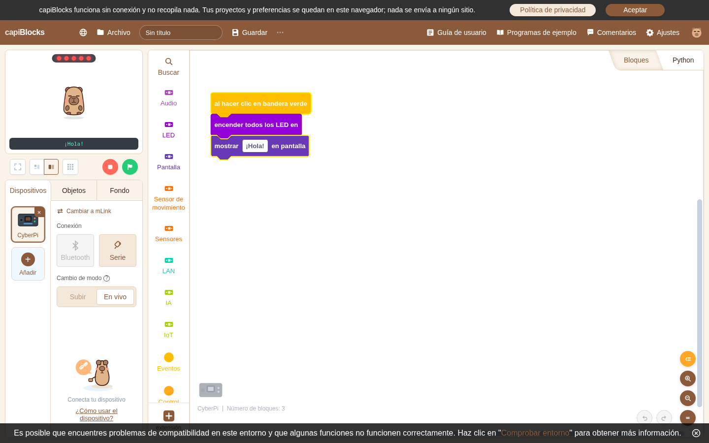

# capiBlocks

IDE de bloques para IoT y robótica, en español y **sin conexión**. Nació como reemplazo de las
herramientas tipo Scratch que usamos en clase (mBlock), para tener una copia propia que no dependa
de un servicio en línea y que se pueda corregir.



## Qué incluye

- Lienzo de bloques real (Blockly, render Scratch): los bloques se **arrastran desde la paleta** o se añaden con un clic, y se encajan entre sí.
- 13 categorías de bloques IoT: Audio, LED, Pantalla, Sensores, LAN, IA, IoT, Eventos, Control,
  Operadores, Variables y bloques propios.
- Dispositivos: **ESP32** (predeterminado y fijado primero), CyberPi, mBot2, Halocode y Arduino Uno.
- Escenario con mascota capibara, simulación de LEDs, pantalla y sonido.
- Tres programas de ejemplo que cargan **bloques reales** en el lienzo, con aviso antes de reemplazar tu trabajo.
- Vista de **Python** generada desde los bloques, en un editor con resaltado de sintaxis, números de línea y Tab.
- Guardar/abrir proyectos en archivo `.json`.
- Interfaz en **español, inglés y chino** (`?lang=es`, `?lang=en`, `?lang=zh`).
- Todo funciona desde el disco (`file://`): cero peticiones a internet.

## Probar

Requiere Node 18 o superior; no hay dependencias que instalar. pnpm y npm sirven igual (los scripts
son Node puro).

```bash
pnpm dev            # desarrollo: construye, sirve y recarga el navegador al guardar
pnpm build          # solo genera dist/
pnpm preview        # sirve dist/ ya construido
pnpm check          # construye y verifica (archivos, sin URLs externas, marca, motor)
```

Con npm: `npm run dev`, `npm run build`, `npm run preview`, `npm run check`.
Sin gestor de paquetes: `node dev.mjs`, `node build.mjs`, `node serve.mjs`, `node check.mjs`.

## Pruebas

```bash
pnpm exec playwright install chromium   # una sola vez
pnpm test        # build + check estático + tests end-to-end
pnpm test:e2e    # solo Playwright
```

Los tests cubren: motor activo, añadir bloques con clic, arrastre desde la paleta, encaje
en pila, Python generado, guardar/restaurar, ejemplos con confirmación, ESP32 por defecto,
sin scroll lateral a 390 px y cero peticiones externas. La lista completa de funcionalidades
está en [docs/FUNCIONALIDADES.md](docs/FUNCIONALIDADES.md).

También puedes abrir `dist/index.html` con doble clic: funciona igual.

## Estructura

```
index.html, style.css, script.js     interfaz y lógica del IDE
i18n.js, locales/locales.js          traducciones es / en / zh
blockly-app.js                       puente con Blockly: bloques, Python, simulación
python-editor.js                     editor Python (CodeMirror) vendorizado
vendor/blockly/, vendor/codemirror/  motores vendorizados (Apache-2.0 / MIT)
build.mjs, serve.mjs, check.mjs      construir, servir, verificar
dist/                                salida del build (no se versiona)
```

## Hoja de ruta

- [ ] Workspace utilizable en teléfono (hoy se oculta en < 768 px).
- [x] Arrastrar bloques desde la paleta al lienzo (el clic sigue disponible).
- [ ] Más bloques IoT y ejemplos para clase.
- [ ] Despliegue automático en GitHub Pages.

## Licencia

MIT. El motor Blockly es Apache-2.0 y se distribuye en `vendor/blockly/`; ver
[THIRD-PARTY-NOTICES.md](THIRD-PARTY-NOTICES.md).

Proyecto educativo sin relación con Makeblock ni con Scratch. "mBlock", "Scratch" y sus logotipos
pertenecen a sus dueños.
